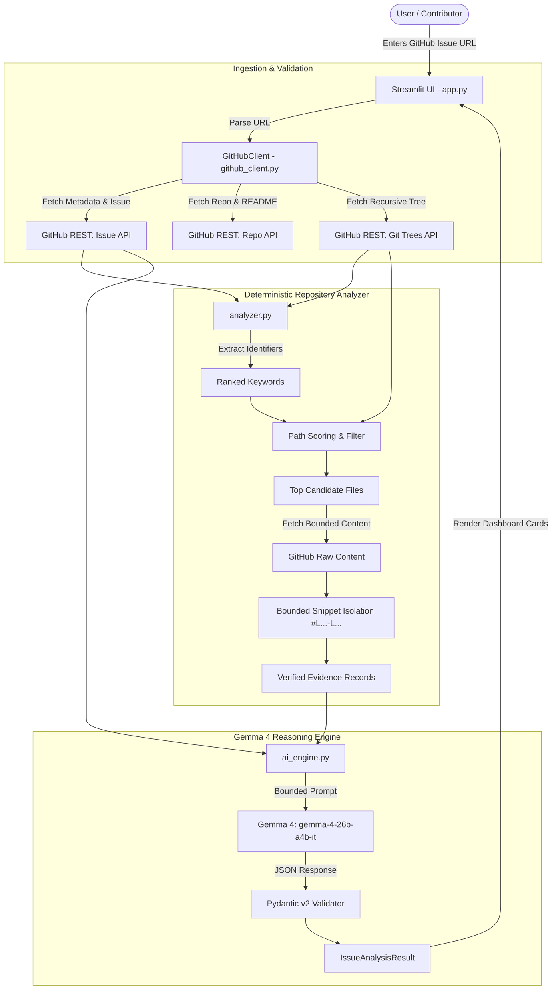

# IssueLens 🔍

> **AI-Powered GitHub Issue Onboarding & Evidence-Grounded Contribution Copilot**  
> *Built for Hackathons with Google Gemma 4 (`gemma-4-26b-a4b-it`) and Streamlit.*

[](LICENSE)
[](https://www.python.org/)
[](https://streamlit.io/)
[-indigo.svg)](https://ai.google.dev/)

---

## 📌 Problem Statement

Every year, thousands of aspiring developers attempt to make their first open-source contributions. However, they routinely encounter three major friction points:

1. **Information Asymmetry:** Issues are often terse, jargon-heavy, or assume deep familiarity with legacy project decisions.
2. **Repository Size & Navigation Paralysis:** In multi-thousand-file repositories, newcomers have no clue which module, function, or directory actually controls the offending behavior.
3. **Hallucination Risk with Generic AI:** Off-the-shelf chatbots frequently invent non-existent files, suggest hallucinated method names, or point to outdated lines, frustrating both the contributor and the maintainer reviewing broken pull requests.

---

## 💡 The Solution: IssueLens

**IssueLens** bridges the gap between raw GitHub issues and actionable, maintainer-ready pull requests. 

Instead of asking a general-purpose AI to guess, IssueLens couples **deterministic repository retrieval** with **Gemma 4** (`gemma-4-26b-a4b-it`):
- It inspects the public GitHub REST API to retrieve the exact issue, README, and full recursive file tree.
- It deterministically extracts code identifiers and scores candidate repository files.
- It pulls bounded, line-numbered source code snippets.
- It prompts Gemma 4 with strict instructions to **separate verified codebase evidence from unverified hypotheses**.
- It validates the response using **Pydantic v2 schemas** into an intuitive dark-mode dashboard tailored for developers.

---

## 🖥️ UI & Architecture Walkthrough

```
+---------------------------------------------------------------------------------------+
|  🔍 IssueLens                     [ gemma-4-26b-a4b-it · Google Gen AI SDK ]          |
|  AI-Powered GitHub Issue Onboarding & Evidence-Based Contribution Guide               |
+---------------------------------------------------------------------------------------+
|  [ https://github.com/pallets/flask/issues/5000                   ] [ 🚀 Analyze ]    |
|  Quick Presets: [ 📌 Flask #5000 ]  [ 📌 Requests #4200 ]                             |
+---------------------------------------------------------------------------------------+
|  pallets / flask #5000 : Deprecate JSON_AS_ASCII in favor of app.json.ensure_ascii     |
|  Reported by: @davidism · Stars: 68,500 · Language: Python · State: OPEN              |
+---------------------------------------------------------------------------------------+
|  [💡 Beginner Guide] [📂 Evidence & Files] [🛠️ Roadmap] [🧪 Tests] [✅ PR Checklist]   |
|                                                                                       |
|  🎓 Plain-English Explanation:                                                        |
|  "Think of Flask's configuration like an old settings dial. Older Flask versions      |
|   used JSON_AS_ASCII = False. The new JSON subsystem uses app.json.ensure_ascii.      |
|   Your task is to emit a deprecation warning whenever someone touches the old key."   |
|                                                                                       |
|  +-----------------------------------+  +-------------------------------------------+ |
|  | ✓ Verified Known Facts            |  | ⚠ AI Hypotheses to Investigate            | |
|  | • Maintainer requested warning   |  | • Warning should also fire in __setitem__ | |
|  | • app.json is replacement         |  | • Backward compatibility mirror needed    | |
|  +-----------------------------------+  +-------------------------------------------+ |
+---------------------------------------------------------------------------------------+
```

---

## ✨ Features

- **Evidence-Based File Discovery:** Never claims a file is relevant without showing the file path, score, and matching identifiers.
- **Strict Distinction Between Evidence & Hypotheses:** Known issue facts are kept distinct from observed code lines and AI-generated hypotheses.
- **Zero-Jargon Beginner Guide:** Translates complex system bugs into accessible analogies for first-time contributors.
- **Actionable Roadmap:** Provides sequential investigation steps followed by a concrete, file-by-file implementation plan.
- **Practical Test Specifications:** Synthesizes realistic test scenarios with sample inputs, expected outputs, and recommended test file locations.
- **Interactive PR Readiness Checklist:** Categorized checklist covering Investigation, Code Changes, Test Runs, Documentation, and Regressions.
- **Deterministic Bounds & Security:** Enforces 60KB file bounds, limits API tree recursion, keeps API keys strictly in-memory or environment variables, and never executes untrusted repository code.
- **Dual Mode (Live & Demo):** Real-time GitHub REST API and Gemma 4 integration with a 1-click verified benchmark mode for zero-latency judging.

---

## 🏗️ Architecture & Data Flow



---

## 🤖 Gemma 4 Integration

IssueLens utilizes the **Gemma 4** open-weights instruction-tuned model (`gemma-4-26b-a4b-it`) hosted via the official Google Gen AI SDK (`google-genai`).

### Key Parameters:
- **Model:** `gemma-4-26b-a4b-it`
- **Temperature:** `0.2` (Low temperature for evidence-grounded determinism)
- **Output Format:** Strict structured JSON conforming to `IssueAnalysisResult` Pydantic model.
- **Context Grounding:** The prompt includes only real repository tokens, tree paths, and extracted code snippets, explicitly forbidding hallucinated identifiers.

---

## 📦 Tech Stack & Dependencies

| Component | Library / Tool | Purpose |
| :--- | :--- | :--- |
| **Frontend** | `streamlit>=1.35.0` | Dark developer dashboard & interactive widgets |
| **AI SDK** | `google-genai>=2.0.0` | Official Google Gen AI client for Gemma 4 |
| **Validation** | `pydantic>=2.7.0` | Strict JSON schema parsing and type enforcement |
| **HTTP Client** | `requests>=2.31.0` | Resilient GitHub REST API querying |
| **Config** | `python-dotenv>=1.0.0` | Environment variable management |
| **Testing** | `unittest` | Automated 8-point QA regression test suite |

---

## 🚀 Installation & Setup

### 1. Prerequisites
- Python 3.10+ (tested on Python 3.10, 3.11, 3.12, 3.13, 3.14)
- Git

### 2. Clone Repository
```bash
git clone https://github.com/your-org/issuelens.git
cd issuelens
```

### 3. Set Up Virtual Environment (Recommended)
```bash
# On Linux/macOS
python3 -m venv venv
source venv/bin/activate

# On Windows (PowerShell)
python -m venv venv
.\venv\Scripts\Activate.ps1
```

### 4. Install Dependencies
```bash
pip install -r requirements.txt
```

### 5. Configure Environment Variables
Copy the example environment file:
```bash
cp .env.example .env
```
Edit `.env` with your API keys:
```env
# Required for Gemma 4 queries (Get key from https://aistudio.google.com/)
GEMINI_API_KEY=your_gemini_api_key_here

# Optional: GitHub token to expand API rate limit from 60 to 5,000 req/hr
GITHUB_TOKEN=your_optional_github_token_here
```
*(Note: You can also enter your API keys directly into the Streamlit sidebar at runtime. Keys are kept in-memory and never logged or committed).*

---

## 🏃 Running the Application

Launch the Streamlit dashboard:
```bash
streamlit run app.py
```
The application will open in your browser at `http://localhost:8501`.

---

## 🧪 Running Automated Tests

Run the complete 8-point automated test suite:
```bash
python tests/test_suite.py
```

### Test Coverage Checklist:
- [x] **Valid GitHub issue:** Verifies issue URL parsing, metadata extraction, and benchmark schema validation.
- [x] **Invalid URL:** Verifies rejection of non-GitHub, incomplete, or malformed URLs with descriptive exceptions.
- [x] **Nonexistent repository:** Verifies clean 404 handling when querying invalid repository owners or names.
- [x] **Missing issue:** Verifies clean 404 handling when an issue number does not exist in an active repository.
- [x] **API rate limit:** Verifies interception of 403/429 status codes and calculation of rate limit reset time.
- [x] **Empty issue description:** Verifies fallback to title/labels when issue author provides no body text.
- [x] **Gemma API failure:** Verifies graceful error recovery on missing keys, 401 unauthenticated, and 429 quota exhaustion.
- [x] **Malformed AI response:** Verifies error trapping on broken JSON and resilient extraction from markdown code fences.

---

## ⚠️ Limitations & Boundary Conditions

- **Public Repositories:** Currently designed for public GitHub repositories; private repositories require a `GITHUB_TOKEN` with `repo` scope.
- **Repository Size Bound:** Repositories with over 4,000 files are sampled at top levels to prevent rate-limit starvation and excessive memory consumption.
- **Binary & Huge Files:** Files over 60KB or non-UTF-8 binary assets are excluded from snippet extraction.
- **Unauthenticated Rate Limits:** The public GitHub API allows 60 unauthenticated requests/hour per IP. For continuous querying, supplying a personal access token is strongly advised.

---

## 🗺️ Future Roadmap

- [ ] **Multi-Repository Context:** Cross-repository issue analysis for workspace monorepos (e.g. Lerna, Turborepo).
- [ ] **AST-Based Symbol Resolution:** Replace regex keyword extraction with Tree-sitter AST parsing for fine-grained call graph tracing.
- [ ] **Local Gemma Runtime:** Support local inference via Ollama or llama.cpp for fully offline and air-gapped development.
- [ ] **Interactive Sandbox:** Integrated Pyodide / WebAssembly environment to execute suggested unit tests in-browser.

---

## 📄 License

This project is licensed under the [MIT License](LICENSE).
