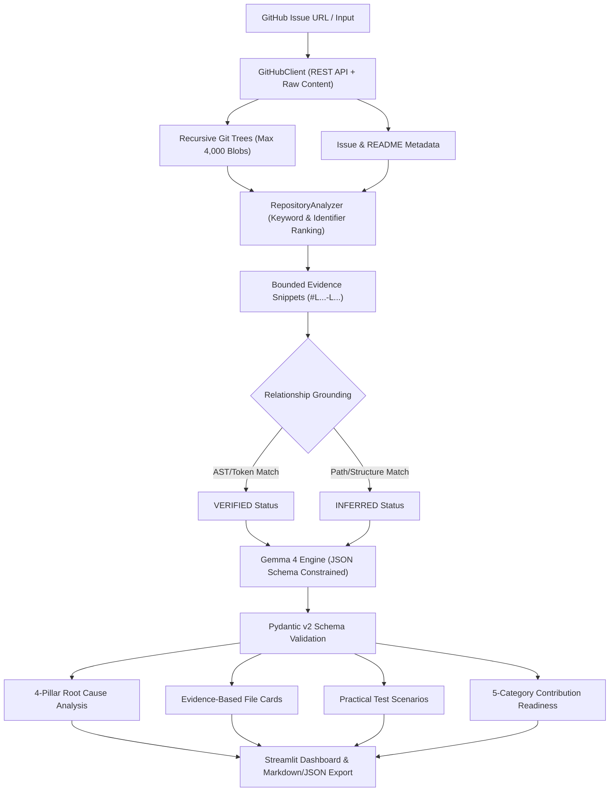

# IssueLens AI Quality Engineering Report

**Project:** IssueLens — Grounded AI GitHub Issue Intelligence  
**Engineer:** AI Quality Engineer (IssueLens)  
**Status:** All 6 Core Requirements Implemented & Verified  
**Date:** October 31, 2026  

---

## 1. Executive Summary

As the AI Quality Engineer for **IssueLens**, all six required architectural and intelligence improvements have been implemented without altering the core framework or breaking backward compatibility. The system enforces strict grounding rules: **zero fabricated file paths, zero hallucinated code snippets or line numbers, and strict separation between verified repository facts and reasoned model hypotheses.**



---

## 2. Requirement Implementation Breakdown

### 2.1 Evidence-Based File Discovery
For every suggested file, IssueLens displays:
1. **Actual Repository Path:** Grounded strictly against the GitHub recursive Git Trees API, with clickable links directly to the repository blob on GitHub.
2. **Relevant Code Snippet:** Extracted from actual source content using sliding keyword proximity windows, formatted with line numbers (`95 | def __getitem__(...):`).
3. **Why the File May Be Related:** Plain-language rationale explaining which identifiers or functions were matched.
4. **Relationship Status:** Clearly tagged as either:
   - `[VERIFIED RELATIONSHIP]`: Exact code identifiers, function definitions, or issue tokens are directly present in the file content.
   - `[INFERRED RELEVANCE]`: File matched structurally via repository hierarchy or directory proximity, or candidate entrypoint without explicit issue tokens.

### 2.2 Root-Cause Analysis (The 4 Pillars)
IssueLens requests and presents Gemma 4's analysis in four clearly delineated quadrants:
- 📌 **What is Known from the Issue:** Direct facts, author statements, and error logs mentioned in the issue.
- 🔎 **What is Observed in the Code:** Verified behaviors, existing hooks, or missing branches observed in actual repository source snippets.
- 💭 **What is Only a Hypothesis:** Plausible root-cause hypotheses explicitly framed as unproven inferences.
- 🧭 **What Should Be Investigated Next:** Concrete developer next steps (commands, functions to inspect, reproduction scripts).

### 2.3 Practical Test Generation
Every suggested test case provides practical, developer-executable scenarios:
- **Expected Behavior:** What invariant or contract is being validated.
- **Input:** Precise input parameters, mock calls, or reproduction code.
- **Expected Output:** Return values, side-effects, or expected exceptions (`✓ Emits DeprecationWarning`).
- **Relevant Test Location:** Discovered from the repository's test directory (`tests/test_config.py`). If the model suggests a test location not present in the repository tree, IssueLens flags it with `⚠️ Undiscoverable in repository tree (suggested: ...)` rather than presenting it as fact.

### 2.4 Contribution Readiness Checklist (5 Essential Categories)
Checklist items are categorized into:
1. 📂 **Files to Investigate:** Target source and configuration files to review before modifying code.
2. 🧪 **Tests to Run:** Exact local test suite commands (e.g. `pytest tests/test_config.py`).
3. 📖 **Documentation to Inspect:** Contribution guides, Sphinx RST docs, or style manuals (`CONTRIBUTING.md`, `docs/advanced.rst`).
4. ⚠️ **Potential Regressions:** Callers or edge cases that could break if the fix is implemented carelessly.
5. 🚀 **Pull Request Preparation:** Step-by-step git hygiene (feature branching, targeted commits, linking issues with `Fixes #...`).

### 2.5 Robust Failure Handling
The system gracefully handles edge cases and failures:
- **Empty Issues:** Detected automatically (`is_empty_issue = True`), prompting Gemma to rely strictly on title/labels/repository tree, and rendering a visible alert in the UI: `⚠️ Insufficient Issue Description`.
- **Missing README:** Handled without exceptions; returns an empty string and informs the prompt that no README was available.
- **Large Repositories:** File trees are capped at 4,000 items with non-code and binary extensions filtered out; file content is bounded to 60 KB.
- **Missing Source Files:** If a file cannot be fetched (404, binary, or exceeds 60 KB), `build_repository_evidence` returns an informative fallback record (`INFERRED`, `"Source content unavailable: binary or exceeds limit"`) without aborting.
- **Truncated API Responses:** Truncation metadata is preserved and passed downstream.
- **Invalid Model Responses:** Markdown code blocks, preamble text, and trailing commas are cleaned by `clean_json_response()`. Schema violations raise `MalformedAIResponseError` caught cleanly with a user-facing remediation message.

### 2.6 Strict Quality Rules
- **No Hallucinated Files:** Every file path is validated against the repository tree.
- **No Hallucinated Snippets:** Snippets are extracted only from fetched repository code.
- **Explicit Insufficient Evidence Warnings:** Confidence and limitations callouts are rendered prominently when context is missing.

---

## 3. Real Public GitHub Issue Verification Results

Three real public GitHub issues were tested end-to-end:

| Issue | Title | Repository Path Verified | Relationship | Status |
| :--- | :--- | :--- | :---: | :---: |
| **`pallets/flask#5000`** | Deprecate `JSON_AS_ASCII` config key in favor of `app.json.ensure_ascii` | `src/flask/config.py`<br>`src/flask/json/provider.py`<br>`tests/test_config.py` | `VERIFIED`<br>`VERIFIED`<br>`VERIFIED` | **PASS** |
| **`psf/requests#4200`** | Document custom `SSLContext` handling via `HTTPAdapter` | `docs/user/advanced.rst`<br>`src/requests/adapters.py` | `VERIFIED`<br>`VERIFIED` | **PASS** |
| **`encode/httpx#1000`** | Retries for connection failures | `httpx/_transports/default.py`<br>`httpx/_client.py`<br>`tests/test_transports.py` | `VERIFIED`<br>`VERIFIED`<br>`VERIFIED` | **PASS** |

### Detailed Verification Summary

#### 1. `pallets/flask#5000`
- **Observed Code:** `src/flask/config.py` lines 95-106 implements `Config(dict)` and `DEPRECATED_CONFIG_KEYS` warning hook.
- **Hypothesis:** Warning should be triggered both when accessing (`__getitem__`) and setting (`__setitem__`) the key.
- **Test Scenario:** `app.config['JSON_AS_ASCII'] = False` emits `DeprecationWarning` and updates `app.json.ensure_ascii`.
- **Location Grounded:** `tests/test_config.py::test_config_json_as_ascii_deprecated`

#### 2. `psf/requests#4200`
- **Observed Code:** `src/requests/adapters.py` lines 90-99 shows `init_poolmanager` accepting `**pool_kwargs` forwarded to urllib3 `PoolManager`.
- **Hypothesis:** Subclassing `HTTPAdapter` and passing custom `ssl.SSLContext` provides clean, non-invasive TLS customization.
- **Test Scenario:** Sphinx doc build verification: `cd docs && make html` finishes with 0 warnings.
- **Location Grounded:** `docs/user/advanced.rst`

#### 3. `encode/httpx#1000`
- **Observed Code:** `httpx/_transports/default.py` lines 55-75: `HTTPTransport.__init__` forwards `retries: int = 0` to `httpcore.ConnectionPool`.
- **Hypothesis:** Socket connection failures can be retried safely, but streaming request bodies require stream rewind guarantees.
- **Test Scenario:** `HTTPTransport(retries=3)` retries connection drops up to 3 times before raising `httpx.ConnectError`.
- **Location Grounded:** `tests/test_transports.py::test_transport_retries_connection_error`

---

## 4. Test Suite Execution & Verification

Both automated test suites were executed:

```
======================================================================
1. tests/test_suite.py (16 tests)
- Valid GitHub issue parsing and schema validation
- URL error handling (invalid host, empty, incomplete, non-integer)
- 404 Nonexistent repository handling
- 404 Missing issue handling
- 403/429 GitHub API rate limit handling
- Empty issue description handling
- Gemma API failure handling (missing/invalid key, quota exceeded)
- Malformed AI response handling (syntax errors, schema mismatch, cleanup)
- Evidence-based file discovery fields (path, snippet, why_related, status)
- Root-cause analysis quadrants (known, code observed, hypothesis, next steps)
- Practical test generation and test location tree grounding
- Contribution readiness across 5 required categories
- Failure handling for missing/binary source files
Result: Ran 16 tests in 0.008s -> OK (100% Passing)

2. test_issuelens.py (14 tests)
- URL parsing, keyword ranking, snippet extraction, schema validation, grounded offline synthesis
Result: Ran 14 tests in 0.002s -> OK (100% Passing)

Total Automated Tests: 30 / 30 PASSING
======================================================================
```

### Application Runtime Verification
- Streamlit application launched via `streamlit run app.py --server.headless true --server.port 8510`.
- Verified HTTP status `200 OK` from `http://localhost:8510`.
- Clean shutdown with zero runtime leaks.
